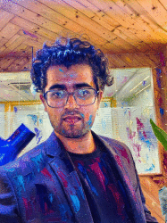

<div align="center">


<br/><br/>



<br/>

<a href="https://github.com/DenverCoder1/readme-typing-svg"></a>

<br/>

<a href="https://portfolio-tharun-gray.vercel.app/"></a>

<br/><br/>

 

</div>

<div align="center"></div>

## ⚡ whoami

```typescript
const tharun99856: Developer = {
  name:      "Tharun Rathod",
  role:      "Frontend or full-stack engineer",
  location:  "Remote",
  currently: "building in public",
  stack:     ["Python", "TypeScript", "JavaScript", "HTML", "TeX", "CSS"],
  mantra:    "Make useful things, then make them delightful 🚀",
};
```

<table>
<tr>
<td width="200" align="center" valign="middle">
  
</td>
<td valign="top">

> Building Edcore | IIT Roorkee EE '27
> Full-Stack Developer • Product Builder • AI Workflows
>
> **Collaborations welcome when they are meaningful 🤝**

</td>
</tr>
</table>

<div align="center"></div>

## ⚔️ Tech Arsenal

<div align="center">


<br/><br/>

**🧠 AI / ML &nbsp;·&nbsp; ⚙️ Automation**

       

</div>

<div align="center"></div>

## 🌌 Featured Projects

<table>
<tr>
<td width="50%" valign="top">

**rune**

An optimizing compiler that chooses your algorithm from intent, and proves it correct. Describe what you want; it picks heap vs sort, BFS vs Dijkstra, Kadane, and more.

`Python` · `4 stars`

<a href="https://github.com/tharun99856/rune"></a>

</td>
<td width="50%" valign="top">

**respondant.github.io**

A featured build from this profile.

`HTML` · `1 stars`

<a href="https://github.com/tharun99856/respondant.github.io"></a>

</td>
</tr>
<tr>
<td width="50%" valign="top">

**dramadapt-qa**

DramAdapt QA: a pre-dubbing quality gate for English -&gt; Telugu microdrama dialogue. Five checks + an unstructured control, scene-batched, with measured token cost and a human editor as the final gate.

`Python` · `0 stars`

<a href="https://github.com/tharun99856/dramadapt-qa"></a>

</td>
<td width="50%" valign="top">

**Oh-my-god**

A featured build from this profile.

`Python` · `0 stars`

<a href="https://github.com/tharun99856/Oh-my-god"></a>

</td>
</tr>
</table>

<details>
<summary><b>More work samples</b> &nbsp;<i>(click to expand)</i></summary>

<br/>

- **Gocomet** - Featured work · <a href="https://github.com/tharun99856/Gocomet"></a>
- **flyo** - Featured work · <a href="https://github.com/tharun99856/flyo"></a>
- **SIP-GUARDIAN-AI-FINANCIAL-CO-PILOT** - Featured work · <a href="https://github.com/tharun99856/SIP-GUARDIAN-AI-FINANCIAL-CO-PILOT"></a>
- **portfolio** - Featured work · <a href="https://github.com/tharun99856/portfolio"></a>

</details>

<div align="center"></div>

## 📊 GitHub Stats

<div align="center">


<br/>


</div>

<div align="center"></div>

<p align="center">
  
</p>

<div align="center"></div>

## 🏆 Beyond the Code

* 🧠 **Profile signal:** 876 contributions in the last year
* 🚀 **Builder energy:** 23 public repositories
* ⭐ **Community signal:** 5 stars across featured work
* 🗣️ **Open to:** interesting collaborations and useful products

<div align="center"></div>

<div align="center">

## 🤝 Let's Build Something Meaningful

I build useful software and enjoy turning ambitious ideas into working products.

<a href="https://portfolio-tharun-gray.vercel.app/"></a>

<br/><br/>

***⭐ From [Tharun Rathod](https://github.com/tharun99856) · built with code, AI & a little chaos 😈***

</div>
